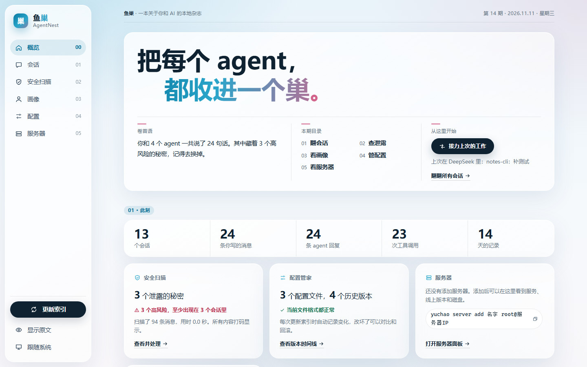
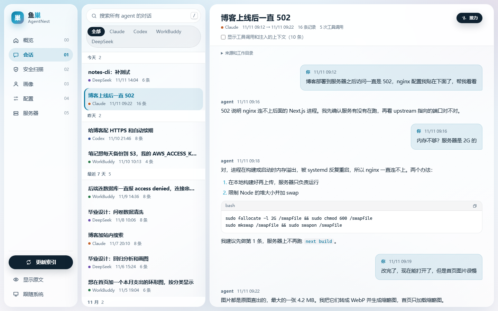
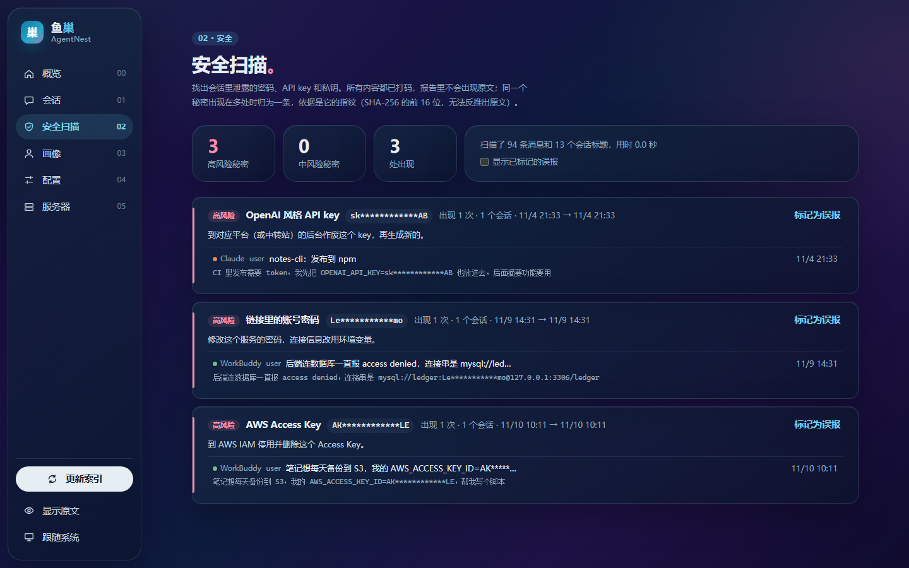
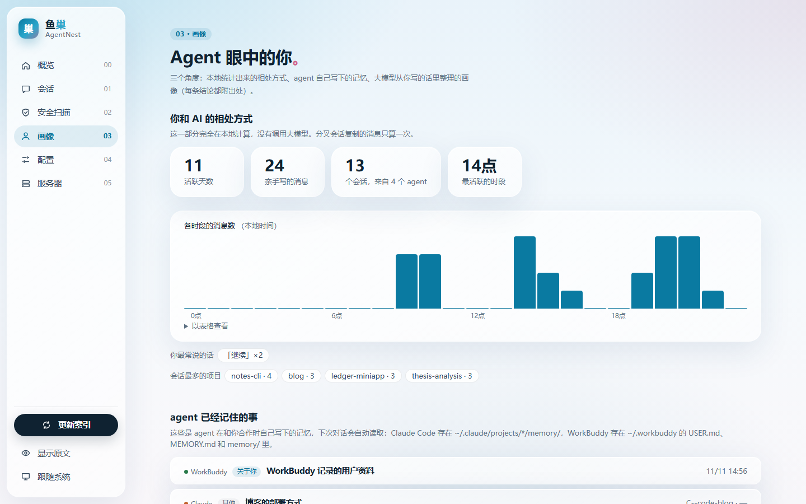
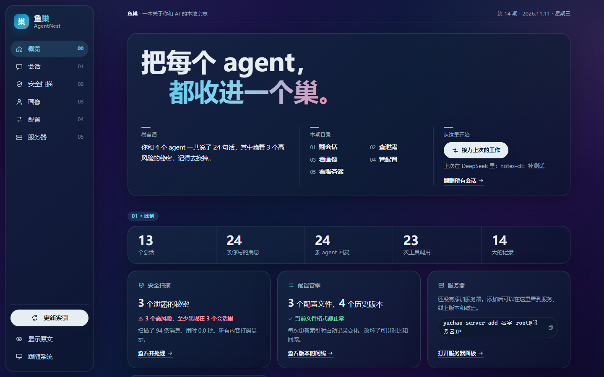

# 鱼巢 AgentNest

[](https://github.com/duyuuu2159/yuchao/actions/workflows/ci.yml)


[](LICENSE)

把 Claude Code、Codex、WorkBuddy、DeepSeek Harness 等多个 AI agent 的本地会话管在一起：一个搜索框搜遍所有 agent 的历史，顺便找出你不小心贴进对话里的密码。



**先试试**——用一套演示数据启动，不读取你电脑上的任何会话：

```bash
npm install
```

```bash
npm run demo
```

然后打开 <http://127.0.0.1:4318>。

## 几个数字

| | |
|---|---|
| 搜索延迟 | 作者本机 6.5 万条真实消息：**P50 15 毫秒，P95 17 毫秒**（优化前 P95 264 毫秒，[过程](docs/perf.md)） |
| 首次建索引 | 10 万条消息约 5 秒，约 2 万条/秒；之后只重新解析有变化的文件 |
| 网页体积 | JS 经 gzip 84 KB，不用任何 UI 库、图标库、Markdown 库；CI 里有 100 KB 的预算 |
| 测试 | 124 个，行覆盖率 95%；端到端测试用临时家目录真实启动命令行，画像生成对着假的大模型接口跑完整流程 |
| 运行时依赖 | 5 个 |

## 能做什么

- **一个搜索框搜所有 agent**：中文全文搜索（SQLite FTS5 trigram，不需要分词词典）；增量索引；子 agent 挂在父会话下；分叉会话复制的历史只出现一次
- **安全扫描**：找出会话里泄露的密码、API key、私钥、服务器凭据；同一个秘密归为一组；界面和报告默认打码
- **接力**：额度用完或上下文太长时，把一个会话整理成交接说明（目标、改过的文件、命令、报错、最后进度），粘贴给另一个 agent 接着做；本地生成，不花钱
- **Agent 眼中的你**：各 agent 写下的关于你的记忆；本地统计你和 AI 的相处方式；用大模型从你写的话里整理画像，每条结论都附出处，程序会剔除模型编造的引用
- **配置管家**：给各个 agent 的配置文件记版本，把散落的旧备份整理成一条时间线，安全回滚
- **服务器面板**：服务状态、线上版本、磁盘、最近的异常；用一把只能运行只读脚本的专用密钥连接
- **单文件程序**：`yuchao.exe` 双击即用，不需要安装 Node.js

| | |
|---|---|
|  |  |
|  |  |

## 本地优先，默认只读

- 只读取本机的会话文件，从不修改
- 唯一会把数据发出本机的功能是生成画像：只发你亲手写的话（已打码），发送前可以预览，必须加 `--yes`
- 本地网页只监听 127.0.0.1，挡住 DNS 重绑定和跨站请求，加了内容安全策略；回滚、生成画像这类有后果的操作只能在命令行执行

完整的威胁模型见 [SECURITY.md](SECURITY.md)。

## 支持的 agent

| agent | 会话位置 | 备注 |
|---|---|---|
| Claude Code | `~/.claude/projects/**/*.jsonl` | 包括子 agent（`subagents/`） |
| Codex | `~/.codex/sessions/`、`~/.codex/archived_sessions/` | 支持 `.jsonl.zst` 压缩文件；标题读自 `session_index.jsonl` |
| WorkBuddy | `~/.workbuddy/projects/**/*.jsonl` | 用户的话从 `<user_query>` 里取；压缩摘要里重放的旧消息不重复计算；记忆读自 `USER.md`、`MEMORY.md` |
| DeepSeek Harness | `~/.dsh/sessions/**/session.v4.jsonl.zstd` | 几千个 zstd 帧首尾相接，按格式逐帧切分解压；子 agent 挂在父会话下 |

每个 agent 是 `src/core/agents.ts` 里的一个适配器（数据目录、会话文件、解析器、配置文件）。接入新的 agent 只需要写一个解析器并注册，索引、搜索、扫描、画像和配置管家都会自动支持。

## 使用

### 直接用 exe

运行 `npm run build:exe` 生成 `dist/yuchao.exe`。双击它会更新索引、启动本地网页并打开浏览器；在命令行里运行则和下面的 `node src/cli/main.ts` 一样，例如 `yuchao.exe search nginx`。

### 从源码运行

需要 Node.js 24 或更新版本（用到了内置的 `node:sqlite`、zstd 解压和 TypeScript 类型擦除）。

```bash
npm install
```

```bash
npm run web:build
```

```bash
node src/cli/main.ts index
```

```bash
node src/cli/main.ts search nginx 回滚
```

```bash
node src/cli/main.ts serve
```

然后打开 <http://127.0.0.1:4317>。

### 命令

| 命令 | 作用 |
|---|---|
| `index` | 扫描并增量索引会话 |
| `search <词...>` | 搜索对话，多个词需同时出现；`--agent <名字>` 只搜某个 agent（claude、codex、workbuddy、dsh），`--tools` 同时搜工具调用 |
| `sessions` | 按最近活动列出会话；`--all` 包含子 agent |
| `show <id>` | 查看完整对话；`--tools` 显示工具调用 |
| `stats` | 索引统计 |
| `scan` | 扫描泄露的密码、密钥和令牌；`--all` 包括已标记的误报，`--json` 输出 JSON |
| `scan ignore <指纹>` | 把一条发现标记为误报（`unignore` 取消） |
| `memories` | 查看各个 agent 写下的关于你的记忆 |
| `profile stats` | 本地统计：活跃时间、项目、常说的话（不调用大模型） |
| `profile preview` | 把将要发给大模型的完整内容写到文件里，发送前检查 |
| `profile build --yes` | 生成画像（会产生费用）；`--scope all` 或某个 agent 的名字 |
| `profile show` / `diff` / `export` | 查看画像和出处、对比两个版本、导出成 CLAUDE.md 片段 |
| `config` | 配置文件状态；`config import` 导入旧备份，`config log <文件>` 查看历史 |
| `config diff <文件> [旧] [新]` | 对比两个版本（已打码） |
| `config restore <版本> --yes` | 回滚，先保存当前内容；损坏的版本需要 `--force` |
| `handoff <会话id> [--to codex]` | 接力：生成交接说明，粘贴给另一个 agent；会话 id 写 `latest` 表示最近一个会话，后面接 `\| clip` 直接复制 |
| `server [名字]` | 服务器面板：服务、版本、磁盘、最近的异常（只读）；`--json` 输出 JSON |
| `server add <名字> <用户名@主机>` | 添加服务器，`--url` 填公网地址用于检查 HTTPS |
| `server setup` | 生成只读专用密钥，打印服务器上需要做的配置 |
| `serve` | 启动本地网页界面，只监听 127.0.0.1，只接受本机 Host，写操作需要自定义请求头 |
| `--version` | 显示版本号 |

索引存放在 `~/.yuchao/index.db`，可用环境变量 `YUCHAO_DB` 修改。

### 服务器面板是怎么保证只读的

`server setup` 在本机生成一把鱼巢专用的 ed25519 密钥，并给出要加进服务器 `authorized_keys` 的一行：

```
restrict,command="/usr/bin/python3 /usr/local/lib/yuchao/status.py" ssh-ed25519 AAAA... yuchao-readonly
```

- `command=` 把这把密钥的登录固定为运行状态脚本（`server/yuchao-status.py`），客户端要求执行什么命令都会被替换掉
- `restrict` 关掉端口转发、终端和代理转发
- 状态脚本只读取信息，输出一份 JSON；日志里的密钥和访客 IP 在本机显示时打码
- 连接时要求服务器指纹已经在 `known_hosts` 里，不会自动信任陌生主机

即使这把密钥泄露，别人也只能看到服务器状态。

### 生成画像用的接口

生成画像会把你写的话（密码、密钥、IP 已打码）发给大模型。支持两种接口格式：

| 方式 | 用法 |
|---|---|
| Anthropic 官方 | 设置环境变量 `ANTHROPIC_API_KEY` |
| 复用 Claude Code 的配置 | `--claude-code-config`，读取 `~/.claude/settings.json` 里的地址和令牌 |
| key 文件 | `--key-file <文件>`，文件里写 `YUCHAO_BASE_URL=`、`YUCHAO_API_KEY=`，可选 `YUCHAO_PROVIDER=openai` |
| 终端输入 | `--base-url <地址> --ask-key`，输入时不显示 |
| OpenAI 兼容格式 | 加 `--provider openai --model <模型名>`，适合只提供 GPT 等模型的中转站 |

`profile models` 可以列出接口上的模型。key 不要写在命令行参数里，以免留在命令历史中。

## 开发

```bash
npm run check
```

一条命令跑完类型检查、代码规范（Biome）和全部测试（含覆盖率下限），和 CI 一样。其它命令和接入新 agent 的步骤见 [CONTRIBUTING.md](CONTRIBUTING.md)。

前端开发时先运行 `node src/cli/main.ts serve`，再运行 `npm run web:dev`，Vite 会把 `/api` 转发给本地服务。

### 目录结构

```
src/core/      解析器、索引、搜索、安全扫描（不依赖界面）
  agents.ts    agent 注册表：每个 agent 的数据目录、会话文件、解析器、配置文件
  parsers/     每种 agent 一个解析器，输出统一的 Session 模型
  lines.ts     逐行读取 JSONL，支持单帧和多帧 zstd
  scan.ts      扫描规则、打码和指纹
  audit.ts     对整个索引做扫描并汇总
  memories.ts  读取 Claude 和 WorkBuddy 的记忆文件
  configs.ts   配置管家：版本、导入备份、校验、回滚
  server.ts    服务器面板：专用密钥、ssh 连接、状态解析、问题判断
  diff.ts      逐行差异对比
  handoff.ts   接力：从会话里提取目标、文件、命令、报错，生成交接说明
  profile/     画像：证据抽取、本地统计、大模型接口、生成与引用校验
src/cli/       命令行入口
src/server/    本地 HTTP API 和静态文件服务
server/        装在服务器上的只读状态脚本
scripts/       打包 exe、性能基准（bench.ts）、演示数据（demo.ts）、包体积预算、发布说明
web/           React 界面（markdown.ts 是自己写的小解析器，ui.tsx 是公共组件）
test/          单元测试和端到端测试（*.e2e.test.ts）；fixtures/ 里是手写的假会话，不含任何真实数据
docs/          架构、性能、计划和开发日志
```

## 文档

| | |
|---|---|
| [docs/architecture.md](docs/architecture.md) | 分层、统一模型、关键设计和取舍 |
| [docs/perf.md](docs/perf.md) | 性能怎么测的、慢在哪里、改了什么，包括没有用的尝试 |
| [SECURITY.md](SECURITY.md) | 威胁模型：保护什么、防谁、怎么防、不防什么 |
| [CONTRIBUTING.md](CONTRIBUTING.md) | 开发命令、接入新 agent 的步骤 |
| [CHANGELOG.md](CHANGELOG.md) | 版本记录 |
| [docs/devlog.md](docs/devlog.md) | 开发日志：每个阶段的决定和踩过的坑 |
| [docs/PLAN.md](docs/PLAN.md) | 路线图（M1–M6 已完成） |

## 许可

MIT
