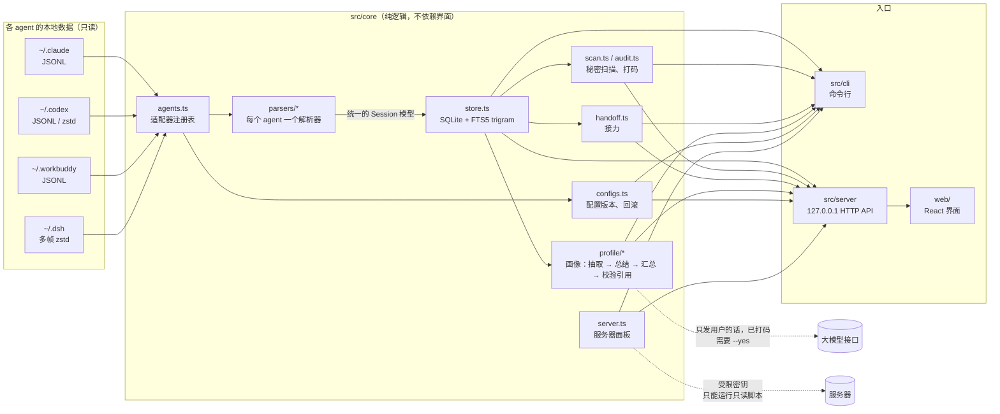

# 架构

## 一张图

## 分层

| 层 | 目录 | 规则 |
|---|---|---|
| 解析 | `src/core/parsers/` | 每个 agent 一个文件，输入一个会话文件路径，输出统一的 `Session`。不碰数据库 |
| 注册表 | `src/core/agents.ts` | 每个 agent 的数据目录、怎么找会话文件、用哪个解析器、跟踪哪些配置文件。其它模块只通过它认识 agent |
| 存储和功能 | `src/core/*.ts` | 索引、搜索、扫描、接力、画像、配置管家。不依赖命令行和界面，所以能直接单元测试 |
| 入口 | `src/cli/`、`src/server/` | 只做参数解析、格式化输出和权限检查，业务逻辑都调 core |
| 界面 | `web/` | 只通过 HTTP API 取数据，不直接读文件 |

**接入一个新 agent** = 在 `types.ts` 的 `AgentKind` 里加一个名字 + 写一个解析器 + 在 `AGENTS` 里注册。索引、搜索、扫描、画像、配置管家、网页筛选都会自动支持。WorkBuddy 和 DeepSeek Harness 就是这样接进来的，没有改动其它模块。

## 统一模型

所有 agent 的会话都转换成 `Session { id, agent, parentId, title, cwd, startedAt, updatedAt, messages[] }`，每条消息有一个 `role`：

| role | 含义 | 默认参与搜索 |
|---|---|---|
| `user` | 用户亲手输入的话 | ✓ |
| `assistant` | agent 的回复 | ✓ |
| `tool_call` | agent 发起的工具调用 | `--tools` |
| `tool_result` | 工具返回的结果（截取前 2000 字） | `--tools` |
| `context` | 客户端自动注入的内容：环境信息、斜杠命令输出、压缩摘要、任务通知 | ✗ |

区分 `user` 和 `context` 是这个项目里最细的一块工作：Claude Code 会把斜杠命令的输出、子任务完成通知、压缩后的历史摘要都以「用户消息」的格式写进文件。如果不区分，搜索结果里全是噪音，画像也会把客户端注入的文字当成用户说的话。

## 关键设计

### 增量索引

- 按文件的修改时间和大小判断有没有变化，没变就跳过。会话文件是追加写入的，变了就整份重新解析——比按行续读简单得多，单个文件解析通常只要几毫秒到几十毫秒
- 首次建索引走批量模式：先只写数据表，最后一次性重建全文索引，比逐行更新快约 4 倍；日常增量继续用触发器逐行更新。细节和数据见 [perf.md](perf.md)
- 解析规则改变时提升 `PARSER_VERSION`，打开数据库时发现版本不同就清空重建，不会留下按旧规则解析的结果

### 中文搜索

- SQLite FTS5 的 `trigram` 分词把文本切成连续三个字的片段，不需要中文分词词典就能搜中文
- 两个字的词（「回滚」「报错」）trigram 匹配不了，退回 `LIKE`；`messages(role, ts)` 索引让它只扫对话，不扫占八成的工具输出
- 多个词之间是「同时出现」
- 分叉会话会复制原会话的全部历史，同一时间、同一角色、同一内容只保留最早的会话，标注「另有 N 处」

### 多帧 zstd

DeepSeek Harness 的会话文件由几千个 zstd 帧首尾相接组成。Node 内置的 zstd 解压只解第一帧，而且不报错——数据被静默截断。`lines.ts` 按 RFC 8878 读取每一帧的帧头，算出帧长度后逐帧切开解压。

### 打码

- 扫描规则覆盖私钥、各家 API key、GitHub 令牌、AWS key、URL 里的账号密码、sshpass、成组写出的服务器凭据等
- **先打码，再截取摘要**：如果先截取再打码，秘密可能正好被截成两半，两半都不再匹配规则而漏掉
- 同一个秘密用指纹归为一组，误报只存指纹，不存原文

### 单文件程序

`npm run build:exe` 用 Node 自带的单文件可执行程序（SEA）：esbuild 把所有 TypeScript 和依赖打成一个 CommonJS 文件，网页文件作为内置资源，一起注入 `node.exe` 的副本。双击后更新索引、启动本地服务、打开浏览器。CI 在 Windows 上打包并实际运行一次。

## 质量保障

| 手段 | 位置 | 守住什么 |
|---|---|---|
| 单元测试 | `test/*.test.ts` | 解析规则、扫描规则、索引一致性、打码 |
| 端到端测试 | `test/cli*.e2e.test.ts` | 用临时家目录真实启动命令行；画像生成对着一个假的大模型接口跑完整流程 |
| 覆盖率下限 | `npm run test:coverage` | 行 90%、分支 80%、函数 85%，低于就失败 |
| 全文索引一致性 | FTS5 `integrity-check` | 批量建索引和增量更新后，全文索引和数据表完全一致 |
| 代码规范 | Biome | 放宽的规则都在 `biome.jsonc` 里写明原因 |
| 包体积预算 | `scripts/check-bundle-size.mjs` | 网页 JS 经 gzip 后不超过 100 KB |
| 性能基准 | `npm run bench` | 冷索引、增量、搜索 P50/P95，可复现 |
| CI | `.github/workflows/ci.yml` | Windows + Linux 上跑以上全部；打包 exe 并试运行 |

## 为什么这样选

| 决定 | 理由 | 放弃了什么 |
|---|---|---|
| Node 24，不用 Python / Rust | `node:sqlite`、zstd、TypeScript 类型擦除都是内置的，核心部分零原生依赖；前后端一种语言 | Rust 的性能和更小的可执行文件 |
| SQLite FTS5，不用 Elasticsearch / 向量库 | 单文件、离线、零运维；作者本机 6.5 万条真实消息上搜索 P95 为 17 毫秒，36 万条合成消息时 P95 约 110 毫秒 | 语义搜索（「意思相近」而不是「字面相同」） |
| 一个包分目录，不拆 monorepo | 一个人开发，多包只增加配置成本 | 模块边界由约定保证，而不是由包管理器强制 |
| 自己写 Markdown 渲染器 | 会话内容不可信，只生成 React 节点最安全；体积也小 | 表格、脚注等不常用的语法 |
| 网页只读，有后果的操作只在命令行 | 本地服务的攻击面越小越好 | 网页上一键回滚的便利 |
| 不用 UI 组件库 | 网页 JS 经 gzip 只有 84 KB | 开发速度 |
